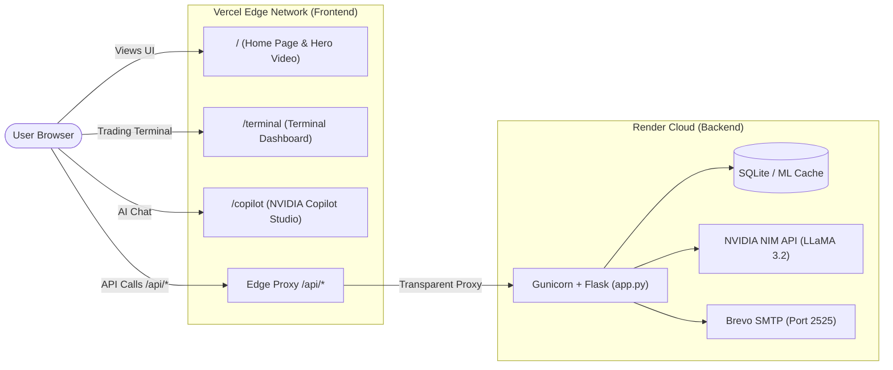

# 🚀 BankSight AI — Production Deployment Guide (Vercel + Render)

This guide walks you through deploying **BankSight AI** using a decoupled cloud architecture:
- **Frontend (Website & Terminal Dashboard):** Hosted on **Vercel** (Global Edge CDN, instantaneous loading, 4K video streaming).
- **Backend (Python Flask & ML Inference):** Hosted on **Render** (Gunicorn WSGI, NVIDIA NIM Meta LLaMA 3.2 AI, Brevo SMTP mail relay).



---

## Part 1: Deploy Backend to Render

### 1. Push Code to GitHub
Ensure all latest files are committed and pushed to your GitHub repository:
```bash
git add .
git commit -m "feat: production vercel and render deployment configs"
git push origin main
```

### 2. Create Render Web Service
1. Log into [Render.com](https://dashboard.render.com).
2. Click **New +** → **Web Service**.
3. Select **Build and deploy from a Git repository** and connect your `BankSight-AI` repository.
4. Configure service settings:
   - **Name:** `banksight-ai-backend` (or your preferred name)
   - **Region:** `Oregon (US West)` or `Frankfurt (EU)`
   - **Branch:** `main`
   - **Root Directory:** *(leave blank)*
   - **Runtime:** `Python 3`
   - **Build Command:** `pip install -r requirements.txt`
   - **Start Command:** `gunicorn --workers 1 --threads 4 --timeout 120 --bind 0.0.0.0:$PORT app:app`
   - **Instance Type:** `Free`

### 3. Add Environment Variables on Render
Under **Environment Variables**, click **Add Environment Variable** and enter:

| Key | Value | Notes |
| :--- | :--- | :--- |
| `PYTHON_VERSION` | `3.11.9` | Required Python runtime |
| `MODE` | `live` | Live NSE banking feeds |
| `DATA_PROVIDER` | `yfinance` | Free real-time Yahoo Finance data |
| `FLASK_DEBUG` | `false` | Production mode |
| `NVIDIA_API_KEY` | *(Copy from your `.env` file)* | NVIDIA NIM API Key |
| `NVIDIA_BASE_URL` | `https://integrate.api.nvidia.com/v1` | NVIDIA NIM endpoint |
| `NVIDIA_MODEL` | `meta/llama-3.2-11b-vision-instruct` | Verified active NVIDIA LLM |
| `SMTP_SERVER` | `smtp-relay.brevo.com` | Brevo Relay Server |
| `SMTP_PORT` | `2525` | Render-compatible cloud port |
| `SMTP_USER` | `bdaa9f001@smtp-brevo.com` | Brevo SMTP login |
| `SMTP_PASSWORD` | *(Copy from your `.env` file)* | Brevo SMTP master key |
| `SMTP_FROM` | `bdaa9f001@smtp-brevo.com` | Sender email address |

> [!NOTE]
> All these environment variables are also pre-configured in `render.yaml`. If you use Render's **Blueprint (Infrastructure as Code)** deployment, Render will automatically import them!

### 4. Deploy and Copy Backend URL
1. Click **Create Web Service**.
2. Render will build wheels and start Gunicorn.
3. Once the build finishes and shows `Your service is live 🎉`, copy your Render URL:
   - Example: `https://banksight-ai-backend.onrender.com`

---

## Part 2: Deploy Frontend to Vercel

### 1. Update `vercel.json` with your Render URL
In `vercel.json` and `dashboard/vercel.json`, replace `https://YOUR_RENDER_BACKEND.onrender.com` with your real Render URL:

```json
{
  "version": 2,
  "cleanUrls": true,
  "rewrites": [
    {
      "source": "/api/(.*)",
      "destination": "https://banksight-ai-backend.onrender.com/api/$1"
    },
    {
      "source": "/terminal",
      "destination": "/dashboard/index.html"
    },
    {
      "source": "/copilot",
      "destination": "/dashboard/manual.html"
    },
    {
      "source": "/manual",
      "destination": "/dashboard/manual.html"
    },
    {
      "source": "/",
      "destination": "/dashboard/manual.html"
    },
    {
      "source": "/(.*)",
      "destination": "/dashboard/$1"
    }
  ]
}
```

Commit and push this change to GitHub:
```bash
git add vercel.json dashboard/vercel.json
git commit -m "chore: connect vercel rewrites to live render backend"
git push origin main
```

### 2. Deploy on Vercel
1. Log into [Vercel.com](https://vercel.com/new).
2. Click **Add New…** → **Project**.
3. Import your `BankSight-AI` repository.
4. Project Configuration:
   - **Framework Preset:** `Other`
   - **Root Directory:** `./` *(leave default root)*
   - **Build & Output Settings:** *(leave empty, static files are served directly)*
5. Click **Deploy**.

---

## Part 3: Architecture & Zero-CORS Magic

### Why this setup is unbeatable:
1. **Zero CORS Issues:**
   The browser on Vercel makes requests to `/api/nvidia/chat` and `/api/nvidia/advisory/SBIN` on the **same domain**. Vercel's edge network securely proxies these requests to your Render backend via the rewrite rule. The browser never experiences CORS blocks.
2. **Global Speed:**
   All heavy media (the 12MB `nvidia-hero.mp4` video, CSS stylesheets, logos) are served directly from Vercel's Edge CDN in under 15ms worldwide.
3. **Brevo Cloud Relay on Port 2525:**
   Render blocks outbound port 25 and 587 on free tiers to prevent spam. Using port `2525` with Brevo ensures automated research report emails send reliably.
4. **NVIDIA Tensor Core Acceleration:**
   API calls route to `https://integrate.api.nvidia.com/v1`, giving instant Meta LLaMA 3.2 quant responses and TreeSHAP quantitative explainability.

---

## Part 4: Verification Checklist

Once both services are deployed, test your live production URLs:

- [ ] **Home Page:** `https://your-app.vercel.app/` (Hero video autoplays, pricing ticks update).
- [ ] **AI Copilot Page:** `https://your-app.vercel.app/copilot` (Ask questions, test quick prompt chips).
- [ ] **Live Terminal Dashboard:** `https://your-app.vercel.app/terminal` (Select a bank, verify the Gemini-style glowing green explain box).
- [ ] **Backend Health:** `https://your-backend.onrender.com/api/health` (Returns `{"status": "ok", "market": "connected"}`).
- [ ] **NVIDIA Advisory:** `https://your-app.vercel.app/api/nvidia/advisory/SBIN` (Returns JSON decision & SHAP weights).
